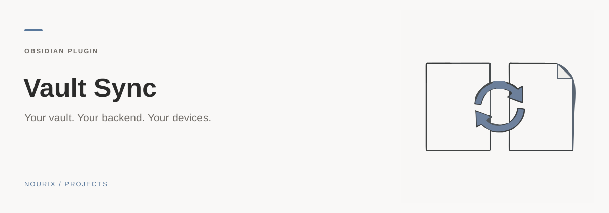
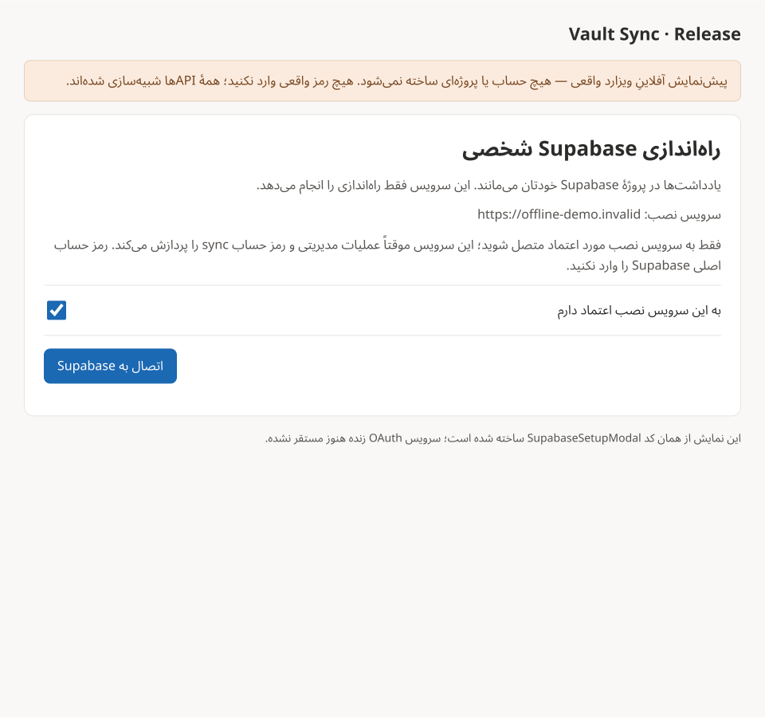
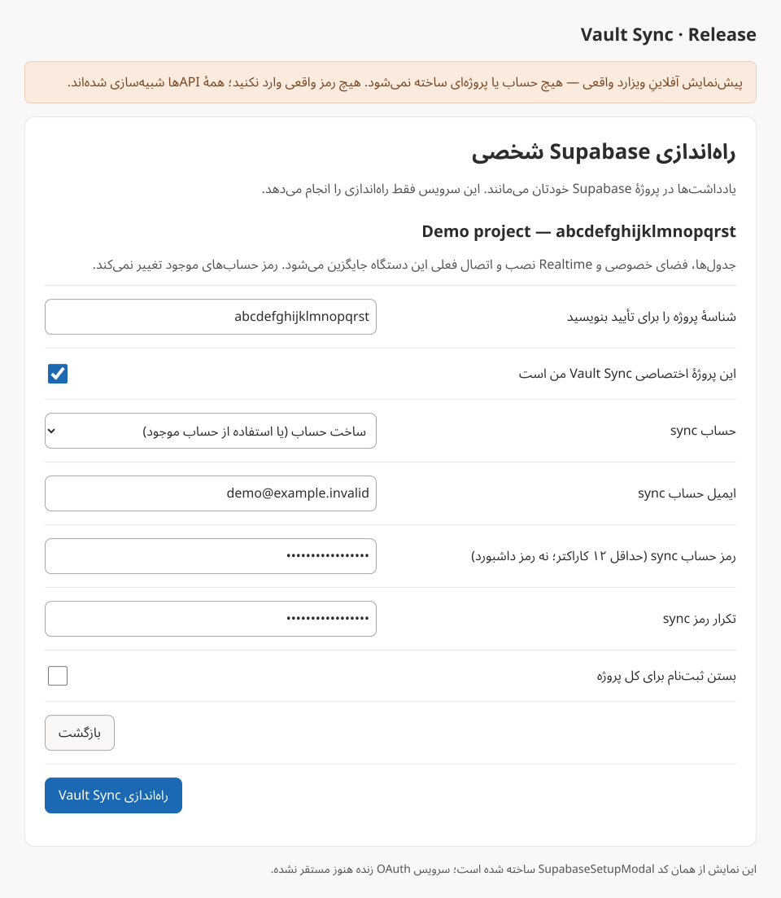
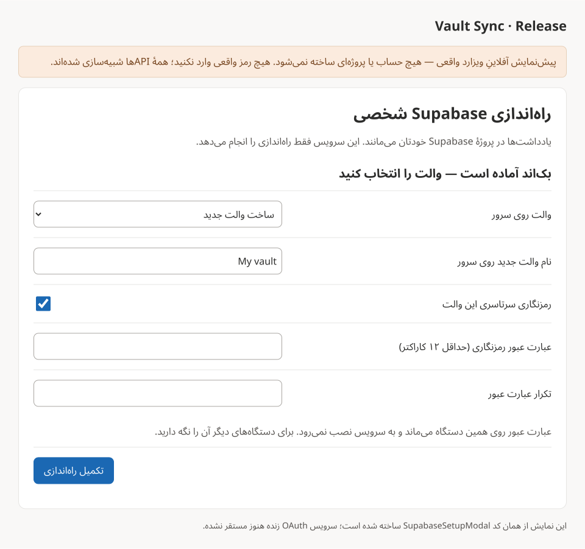

<sub>کاور مفهومی تولیدشده با هوش مصنوعی؛ اسکرین‌شات برنامه نیست.</sub>

<div align="center">

# Vault Sync

[English](README.en.md)

**والت شما. Supabase شما. دستگاه‌های شما.**

همگام‌سازی یادداشت‌ها و فایل‌های Obsidian بین گوشی و کامپیوتر، با پروژهٔ شخصی Supabase.

[](https://obsidian.md)
[](https://supabase.com)
[](LICENSE)
[](https://github.com/Ali-Nourix/Obsidian-Valut-Sync)

**Desktop + Mobile · فارسی / English · رمزنگاری اختیاری · مدیریت تعارض**

[**نصب**](#installation) · [**راه‌اندازی**](#setup) · [**تصاویر**](#screenshots) · [**امنیت**](#security)

</div>

---

> شاخهٔ `Release` هنوز پیش از انتشار عمومی است. نصب زنده و تست واقعی دسکتاپ/موبایل باید تکمیل شود؛ فعلاً برای امتحان این شاخه، سورس را build کنید.

## از اینجا شروع کنید

| نیاز شما | راهنما |
| --- | --- |
| دستگاه اول | [نصب](#installation) · [راه‌اندازی](#setup) |
| امنیت و محدودیت‌ها | [نکات امنیتی](#security) |
| پیش از انتشار | [چک‌لیست دستگاه واقعی](docs/device-test-checklist.md) · [راهنمای آفلاین](docs/setup/index.html) |

همگام‌سازی جایگزین پشتیبان نیست. از پروژهٔ اختصاصی Supabase استفاده کنید و توکن موقت نصب را پس از راه‌اندازی لغو کنید.

## نصب پلاگین

<a id="installation"></a>

اگر بستهٔ آماده در [Releases](https://github.com/Ali-Nourix/Obsidian-Valut-Sync/releases) موجود است، سه فایل `main.js`، `manifest.json` و `styles.css` را از همان نسخه بگیرید و در این پوشهٔ والت قرار دهید:

```text
<vault>/.obsidian/plugins/vault-sync/
```

در Obsidian به **Settings → Community plugins** بروید؛ در صورت نیاز Restricted mode را خاموش و Vault Sync را فعال کنید.

**برای build شاخهٔ فعلی**، Node.js **22+** لازم است:

```bash
git clone --branch Release https://github.com/Ali-Nourix/Obsidian-Valut-Sync.git
cd Obsidian-Valut-Sync
npm ci
npm run build
```

بعد همان سه فایل را به پوشهٔ پلاگین کپی کنید. ZIP گزینهٔ **Code → Download ZIP** سورس است، نه بستهٔ آمادهٔ نصب. از آنجا که مخزن عمومی است، سورس از طریق GitHub قابل دریافت است.

## راه‌اندازی — فقط روی دستگاه اول

<a id="setup"></a>

پیش از شروع از والت بکاپ بگیرید. **همگام‌سازی جایگزین بکاپ نیست.**

### ۱. پروژهٔ خودتان را بسازید

وارد [Supabase Dashboard](https://supabase.com/dashboard) شوید، یک پروژهٔ **اختصاصی و خالی** برای Vault Sync بسازید و تا آماده‌شدن آن صبر کنید. شناسهٔ ۲۰ کاراکتری پروژه را از تنظیمات یا آدرس داشبورد بردارید.

از پروژهٔ اصلی سایت یا برنامهٔ دیگری استفاده نکنید. هزینه و ظرفیت به پلن Supabase شما بستگی دارد.

### ۲. توکن موقت نصب بسازید

در [Access Tokens](https://supabase.com/dashboard/account/tokens)، **Generate new token** را بزنید:

- یک توکن **Scoped** بسازید؛ نه **Legacy / Account-wide**.
- فقط **همان پروژهٔ Vault Sync** را انتخاب کنید.
- نام دلخواه، مثلاً `Vault Sync setup`، و انقضای کوتاه مناسب نصب تعیین کنید.
- فقط این چهار دسترسی را انتخاب کنید، سپس **Review access → Create token** را بزنید:

| Permission | Access |
| --- | --- |
| Project Settings | Read |
| Database | Read-write |
| API Keys | Read |
| API Key Secrets | Read |

`API Key Secrets: Read` برای **ساخت خودکار حساب sync** لازم است. این دسترسی‌ها قدرتمندند؛ توکن را فقط به پروژهٔ اختصاصی محدود کنید. دسترسی سازمان، پرداخت، همهٔ پروژه‌ها یا تغییر Auth Config لازم نیست.

توکن Scoped با `sbp_fc` شروع می‌شود. این [راهنمای رسمی](https://supabase.com/docs/guides/platform/personal-access-tokens) جزئیات مجوزها را توضیح می‌دهد. لینک بالا صفحهٔ توکن را باز می‌کند؛ انتخاب دسترسی‌ها در داشبورد با خود شماست.

### ۳. بقیهٔ نصب را به پلاگین بسپارید

در تنظیمات Vault Sync:

1. **نصب مستقیم با توکن محدود خودتان** را باز کنید.
2. شناسهٔ پروژه و توکن موقت را وارد و مدیریت موقت همین پروژه را تأیید کنید.
3. **اتصال به Supabase** را بزنید؛ نام پروژه را بررسی و شناسه را برای تأیید مقصد دوباره بنویسید.
4. گزینهٔ **ساخت خودکار حساب sync** را نگه دارید و ایمیل و یک رمز مستقل با حداقل **۱۲ کاراکتر** وارد کنید؛ رمز را دوباره بنویسید.
5. **راه‌اندازی Vault Sync** را بزنید. پلاگین بک‌اند را آماده می‌کند، کاربر را **داخل همین پروژه** می‌سازد و تأیید می‌کند و ورود را می‌آزماید. **Add user دستی لازم نیست.**
6. یک والت جدید بسازید یا والت موجود را انتخاب کنید. اگر رمزنگاری را فعال می‌کنید، عبارت عبور را برای دستگاه‌های بعدی نگه دارید.

رمز بالا برای حساب sync است، **نه رمز اصلی داشبورد Supabase**. اگر ایمیل از قبل در همان پروژه کاربر دارد، رمز فعلی همان حساب را وارد کنید؛ پلاگین آن را تغییر نمی‌دهد. «استفاده از حساب موجود» هم برای کاربران قبلی در دسترس است.

### ۴. توکن نصب را لغو کنید

به [Access Tokens](https://supabase.com/dashboard/account/tokens) برگردید و توکن را **Revoke** کنید. برای sync یا دستگاه دوم دیگر به آن نیاز ندارید. پاک‌شدن توکن از حافظهٔ پلاگین، جای لغو آن در Supabase را نمی‌گیرد.

[راهنمای وب](docs/setup/index.html) را نیز می‌توانید محلی باز کنید؛ این صفحه هیچ توکن یا رمزی دریافت نمی‌کند.

## اتصال دستگاه دوم

1. پلاگین را روی دستگاه دوم نصب کنید.
2. **همان Project URL و publishable/anon key** را وارد کنید؛ از تنظیمات دستگاه اول بردارید.
3. با **همان ایمیل و رمز حساب sync** وارد شوید.
4. **همان والت** را انتخاب کنید؛ والت جدید نسازید.
5. اگر رمزنگاری روشن است، عبارت عبور همان والت را وارد کنید.

پروژه، حساب یا توکن نصب جدید لازم نیست. Obsidian را روی هر دو دستگاه باز کنید، **Sync now** را بزنید و رفت‌وبرگشت یک یادداشت آزمایشی را بررسی کنید.

## تصاویر

<a id="screenshots"></a>

این تصاویر پیش‌نمایش آفلاینِ کد ویزارد با داده‌های نمونه‌اند؛ نه مدرک نصب زنده روی Supabase.



<details>
<summary>ساخت خودکار حساب sync و انتخاب والت</summary>





</details>

## امنیت و نکات مهم

<a id="security"></a>

- توکن نصب را **فقط در پنجرهٔ نصب** وارد کنید؛ نه فیلد Publishable key، وب‌صفحه، issue یا chat.
- در تنظیمات عادی فقط URL و کلید **publishable/anon** قرار می‌گیرد؛ کلید **secret/service_role** را وارد نکنید.
- پلاگین به سرور نصب سازنده نیاز ندارد. توکن و کلید مدیریتی در تنظیمات یا لاگ ذخیره نمی‌شوند و فقط موقتاً در حافظهٔ نصب‌اند.
- رمزنگاری اختیاری روی دستگاه انجام می‌شود. عبارت عبور را نگه دارید؛ سرور نمی‌تواند آن را بازیابی کند.
- بستن پنجره، تغییرات انجام‌شده در پروژه را برنمی‌گرداند. درخواست ارسال‌شده ممکن است کامل شود.
- Supabase واسط انتقال است، نه آرشیو دائمی. اگر دستگاه جدید منتظر فایل است، Obsidian را روی دستگاه قبلی هم باز کنید.
- پوشه‌های مخفی مثل `.obsidian` و `.trash` همگام نمی‌شوند. فعالیت پس‌زمینهٔ گوشی محدود است.

## رفع مشکل

| مشکل | راه‌حل |
| --- | --- |
| توکن پذیرفته نمی‌شود | Scoped بودن، پروژه، انقضا و چهار مجوز بالا را بررسی کنید |
| حساب ساخته نمی‌شود | مجوز API Key Secrets: Read، ایمیل و شرایط رمز پروژه را بررسی کنید |
| ایمیل از قبل وجود دارد | رمز فعلی همان حساب را وارد کنید؛ رمز آن خودکار عوض نمی‌شود |
| پروژه آماده نیست | تا فعال‌شدن پروژه صبر کنید و دوباره متصل شوید |
| ورود ناموفق است | ایمیل و رمز حساب sync را بررسی کنید، نه حساب داشبورد Supabase |
| فایل‌ها در راه‌اند | Obsidian را روی دستگاه قبلی باز کنید تا فایل‌ها ارسال شوند |

برای گزارش مشکل از [Issues](https://github.com/Ali-Nourix/Obsidian-Valut-Sync/issues) استفاده کنید؛ اطلاعات حساس نفرستید.

## توسعه

```bash
npm test
npm run build
npm run preview:onboarding
```

تست‌های نصب آفلاین‌اند. پیش از انتشار، [چک‌لیست دستگاه واقعی](docs/device-test-checklist.md) را اجرا کنید.

## مجوز

[GNU General Public License v3.0](LICENSE)
